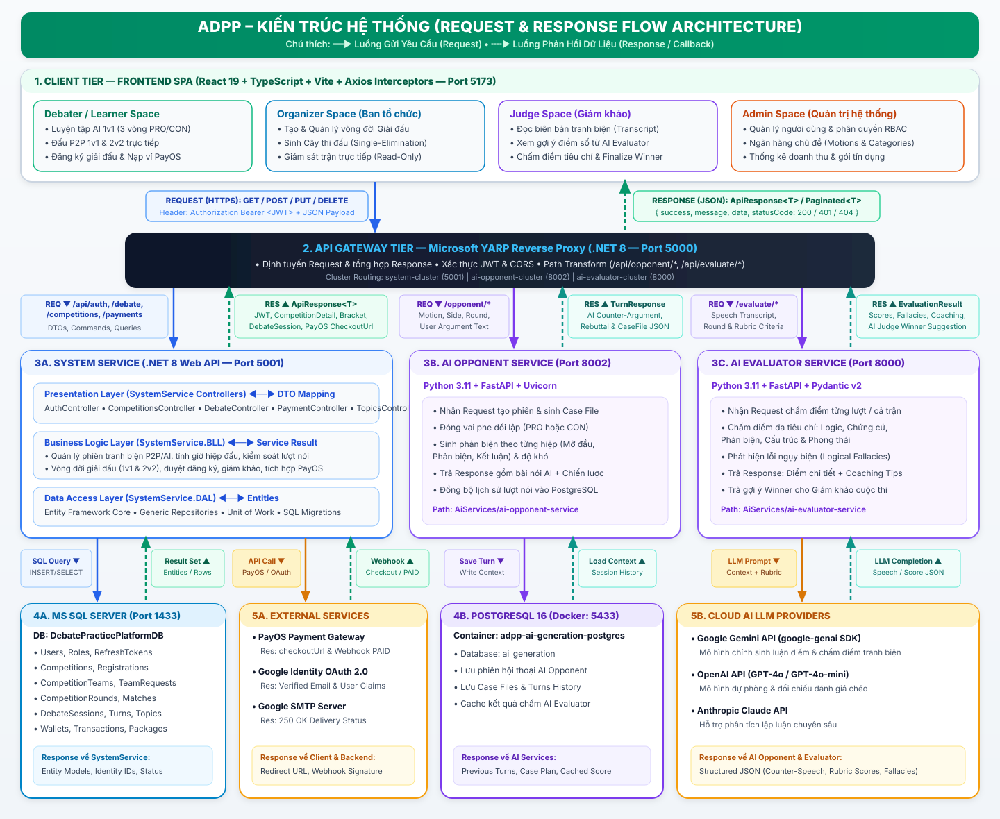
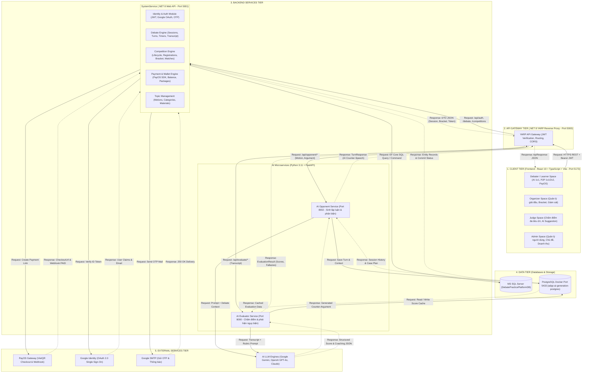
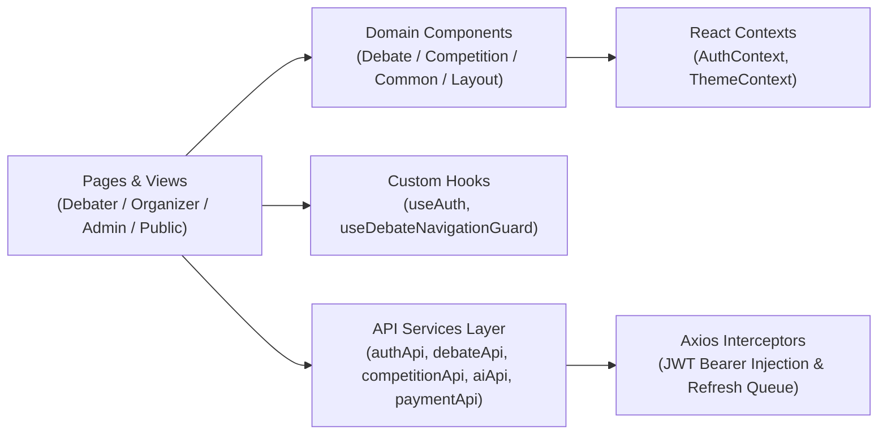
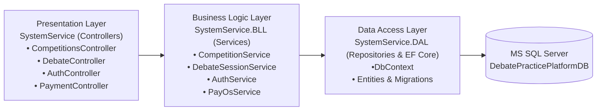
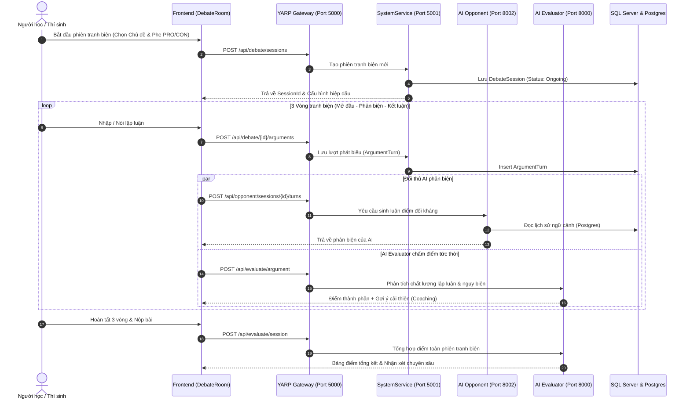
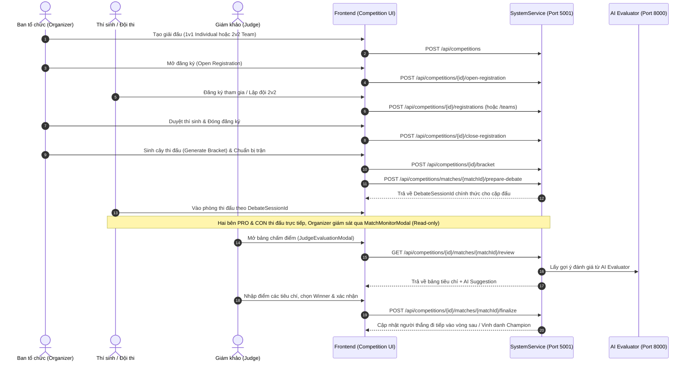

# ADPP – TÀI LIỆU KIẾN TRÚC HỆ THỐNG (SYSTEM ARCHITECTURE)

**Dự án:** AI Debate Practice Platform (ADPP) – Nền tảng Luyện tập Tranh biện ứng dụng Trí tuệ Nhân tạo  
**Mã đề tài:** SEP409 – KLTN Kì 9 FPT University  
**Ngày cập nhật:** 09/11/2026

---

## 1. TỔNG QUAN KIẾN TRÚC (ARCHITECTURE OVERVIEW)

Hệ thống **ADPP** được thiết kế theo mô hình **Microservices kết hợp API Gateway**, tách biệt rõ ràng giữa:
1. **Frontend SPA (React 19 + TypeScript + Vite):** Đảm nhiệm trải nghiệm người dùng theo thời gian thực cho 4 vai trò (Debater, Organizer, Judge, Admin).
2. **API Gateway (.NET 8 YARP):** Điểm tiếp nhận tập trung (Single Point of Entry), điều phối luồng request tới các dịch vụ phía sau.
3. **Core System Service (.NET 8 Clean Architecture - 3-Tier):** Xử lý nghiệp vụ lõi có tính toàn vẹn giao dịch cao (Tài khoản, Giải đấu, Trận đấu, Phòng tranh biện, Ví & Thanh toán PayOS).
4. **AI Microservices (Python FastAPI):** Tách rời 2 dịch vụ chuyên biệt gồm **AI Opponent** (Đối thủ tranh biện tự động) và **AI Evaluator** (Chấm điểm, phân tích lập luận & phát hiện ngụy biện).

---

## 2. SƠ ĐỒ KIẾN TRÚC TỔNG THỂ (HIGH-LEVEL SYSTEM ARCHITECTURE)

---

## 3. KIẾN TRÚC PHÂN TẦNG NỘI BỘ (INTERNAL LAYER ARCHITECTURE)

### 3.1. Kiến trúc Frontend (`d:\Kì_9_FPT\KLTN\Front-end-ADPP\src`)

### 3.2. Kiến trúc Backend SystemService (`SEP409-AI-DEBATE/Services`)

---

## 4. SƠ ĐỒ TUẦN TỰ CÁC LUỒNG NGHIỆP VỤ CHÍNH (CORE SEQUENCE DIAGRAMS)

### 4.1. Luồng Tranh biện với AI & Chấm điểm Tự động (Debate & AI Evaluation Flow)

### 4.2. Luồng Giải đấu & Chấm thi Giám khảo (Competition & Judge Scoring Flow)

---

## 5. VỊ TRÍ THƯC TẾ CỦA CÁC THÀNH PHẦN TRONG WORKSPACE

| Thành phần | Đường dẫn thư mục trong dự án | Công nghệ | Cổng (Port) |
| :--- | :--- | :--- | :---: |
| **Frontend Web App** | `d:\Kì_9_FPT\KLTN\Front-end-ADPP\src` | React 19, TypeScript, Tailwind v4, Vite | `5173` |
| **API Gateway** | `d:\Kì_9_FPT\KLTN\Front-end-ADPP\SEP409-AI-DEBATE\Gateway` | .NET 8, YARP Reverse Proxy | `5000` |
| **System Service (API)** | `d:\Kì_9_FPT\KLTN\Front-end-ADPP\SEP409-AI-DEBATE\Services\SystemService` | .NET 8 Web API | `5001` |
| **System Service (BLL)** | `d:\Kì_9_FPT\KLTN\Front-end-ADPP\SEP409-AI-DEBATE\Services\SystemService.BLL` | C# Class Library (Business Logic) | - |
| **System Service (DAL)** | `d:\Kì_9_FPT\KLTN\Front-end-ADPP\SEP409-AI-DEBATE\Services\SystemService.DAL` | EF Core, Repositories, Entities | - |
| **AI Evaluator Service** | `d:\Kì_9_FPT\KLTN\Front-end-ADPP\SEP409-AI-DEBATE\AiServices\ai-evaluator-service` | Python, FastAPI, Google GenAI / OpenAI | `8000` |
| **AI Opponent Service** | `d:\Kì_9_FPT\KLTN\Front-end-ADPP\SEP409-AI-DEBATE\AiServices\ai-opponent-service` | Python, FastAPI, SQLAlchemy, Alembic | `8002` |
| **PostgreSQL AI DB** | `SEP409-AI-DEBATE\AiServices\ai-opponent-service\docker-compose.yml` | PostgreSQL 16 Alpine (Docker) | `5433` |
| **Script khởi chạy tổng** | `d:\Kì_9_FPT\KLTN\Front-end-ADPP\SEP409-AI-DEBATE\start-all.ps1` | PowerShell Automation | - |

